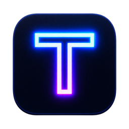
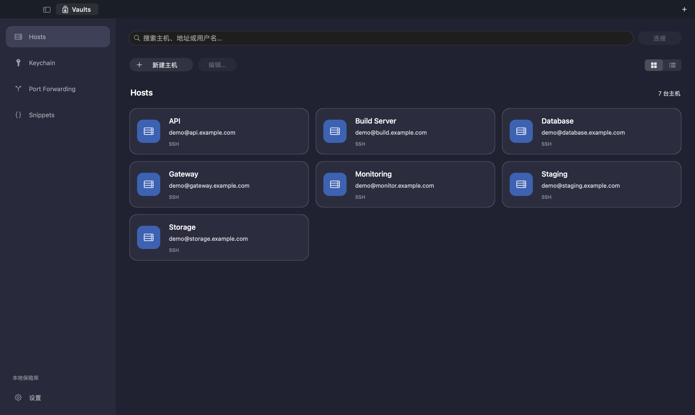

<p align="center">
  
</p>

<h1 align="center">Termes</h1>

<p align="center"><strong>在 Mac 上连接服务器、管理文件，处理日常远程工作。</strong></p>
<p align="center">SSH · SFTP · 多标签与分屏 · 服务器监控 · 端口转发</p>

<p align="center">
  <a href="#功能">功能</a> ·
  <a href="#开始使用">开始使用</a> ·
  <a href="#快捷键">快捷键</a> ·
  <a href="https://github.com/swlfigo/shell/issues">反馈建议</a>
</p>

Termes 是一款面向 macOS 的 SSH 客户端。在 Vaults 中找到所有主机，用标签和分屏同时处理多个会话，在终端旁浏览文件、查看服务器状态，把常用的远程操作集中在一个工作区。

<picture>
  <source media="(prefers-color-scheme: dark)" srcset="docs/images/vaults-home-dark.png">
  <source media="(prefers-color-scheme: light)" srcset="docs/images/vaults-home-light.png">
  
</picture>

*Vaults 首页，支持深色与浅色外观。截图中的主机为示例配置。*

## 功能

### 主机与密钥管理

- **Hosts** 集中展示已保存的服务器，支持卡片与列表视图，按名称、地址或用户名搜索，双击即可连接。
- 支持密码、私钥和带口令的私钥登录；在 **Keychain** 中导入、重命名、替换和复用私钥，查看关联主机与指纹。
- 支持多级 SSH 跳板机，连接需要经过入口服务器访问的内网主机。
- 首次连接时确认服务器指纹；指纹变化时阻止连接，并显示原因。

### 终端与多会话工作区

- 通过标签、分屏和多个窗口同时操作不同服务器，可调整分屏比例、最大化窗格，以及在窗口之间移动会话。
- 切换标签、返回 Vaults 或收起工具面板时，保留当前会话和已输入内容。
- 支持复制粘贴与历史输出滚动；阅读历史时，新输出通过提示条提醒，点击即可回到底部。
- 意外断线后自动尝试重连，可查看连接阶段与日志，也可立即重试或取消。

### SFTP 文件管理

- 在终端旁浏览本机和远端目录，上传、下载文件及整个文件夹。
- 传输队列显示进度，支持暂停、继续、重试和取消，普通文件支持断点续传。
- 新建远端目录、重命名、删除条目，以及查看和修改文件权限。
- 直接编辑远端 UTF-8 文本文件并保存回服务器；有未保存内容时提醒，也可将草稿另存到本机。

### 服务器状态监控

- 在 **工具 → 概览** 查看 Linux 服务器的 CPU、内存、磁盘、网络、负载和运行时长，无需额外安装监控程序。
- 查看最近 1、5 或 15 分钟的趋势，按网络接口查看流量，随时暂停或恢复采样。
- 概览与文件工具可以切换，收起面板后保留监控历史。

### 端口转发与代理

- **本地转发**：通过 Mac 上的端口访问服务器或内网中的服务。
- **远端转发**：让服务器通过指定端口访问 Mac 上的本地服务。
- **SOCKS5 代理**：让支持代理的应用通过 SSH 服务器访问目标地址。
- 在 **Port Forwarding** 中保存和编辑规则，连接后手动启动，随时查看状态与停止转发。

### 常用命令与脚本

- 在 **Snippets** 中保存常用命令和多行脚本，按分组整理。
- 使用参数模板复用相同操作，插入前填写本次需要的参数并预览内容。
- 命令插入当前终端后等待按回车执行，方便再次检查目标和内容。

### 外观定制

- 支持跟随系统、浅色和深色界面，以及多种终端配色主题。
- 调整等宽字体、字号和默认文字颜色，通过即时预览选择适合自己的阅读方式。

## 开始使用

需要 **macOS 13 或更新版本**。项目仍在开发中，当前通过源码运行。

1. 打开 Termes，在 **Vaults → Hosts** 点击 **新建主机**。
2. 填写名称、主机地址、端口和用户名，选择密码或私钥；需要时设置跳板机。
3. 保存连接并点击 **连接**，首次连接时核对服务器指纹。
4. 连接后使用终端，通过 **工具 → 文件 / 概览** 打开文件管理或服务器监控。需要连接其他主机时，可随时返回 Vaults。

## 后台运行与会话恢复

| 操作 | 行为 |
| --- | --- |
| 点击黄色最小化按钮 | 最小化窗口，连接和任务继续运行。 |
| 点击红色关闭按钮 | 将窗口收起到后台，保留会话、传输和端口转发。 |
| 点击 Dock 图标 | 恢复原窗口和会话。 |
| 关闭会话标签或窗格 | 有活动连接时先确认，再断开对应会话。 |
| 按 ⌘Q 退出 | 有未结束工作时，可选「后台运行（保持连接）」「断开并退出」或「取消」；没有任务时直接退出。 |

重新启动应用时，会恢复窗口、标签、分屏布局和连接草稿，需要手动重新连接。终端输出、传输队列、监控历史和未保存的编辑内容不会跨重启保留。

## 快捷键

| 快捷键 | 操作 |
| --- | --- |
| ⌘T | 新建连接标签 |
| ⌘N | 新建窗口 |
| ⌘W | 关闭当前会话窗格；在 Vaults 首页收起窗口 |
| ⌘D | 复制当前会话到新标签 |
| ⌘1 … ⌘9 | 切换标签 |
| ⌘⇧[ / ⌘⇧] | 上一个 / 下一个标签 |
| ⇧⌘H | 返回 Vaults 首页 |
| ⌥⌘I | 展开或收起服务器工具 |
| ⌘, | 打开外观设置 |

## 本地数据与导入导出

连接信息保存在本机，密码、私钥及私钥口令保存在这台 Mac 的系统钥匙串中。支持导出和导入连接列表，导出文件不包含密码、私钥内容或口令；导入到另一台 Mac 后，需要重新补充凭据。

## 当前状态

- 提供 macOS 应用，以及正在开发的 iPhone / iPad 首版界面（iOS / iPadOS 17 或更新版本）。移动端支持主机管理、SSH 终端、多会话切换、服务器监控和外观设置，详见下方说明。跨设备云同步仍在规划中。
- 服务器状态监控目前支持 Linux。
- 调整终端宽度时，部分中文历史日志可能出现空白或错位。查看大量中文日志时建议先固定窗口宽度；已有日志错排时，可在窗口宽度固定后新建会话并重新读取日志。

## iPhone 与 iPad

在 Xcode 中打开 `Termes.xcodeproj`，选择 **TermesMobile** Scheme，在 iPhone 或 iPad 模拟器上运行。真机运行需要在该 Target 的 Signing 设置中选择自己的开发团队。

移动端界面使用 **UIKit + SnapKit**，通过 `UISplitViewController` 和 `UINavigationController` 适配设备尺寸，终端使用 SwiftTerm 的 UIKit 视图。首版已经接入现有 `TermesKit` / `SSHCore`，使用真实 SSH 连接：

- iPhone 使用主机列表与终端之间的单栏导航，iPad 使用可收起侧栏的双栏工作区，支持横竖屏和窄窗口；首版使用单窗口工作区。
- 新建、搜索、编辑和删除主机；支持密码、导入私钥、复用已存私钥和跳板机。编辑时默认保留已有凭据。
- 首次连接核对主机指纹，查看连接阶段与日志，取消连接、断开和重连。
- 长按主机可以打开多个独立会话。切换会话或返回主机列表保留连接与终端输出；关闭活动会话需要确认。
- 编辑主机配置后会打开新会话，原会话保留原来的目标与终端输出。
- SwiftTerm UIKit 终端支持文本选择、复制粘贴、历史滚动、外接键盘，以及屏幕键盘上的 Esc、Tab、Ctrl 和方向键。旋转屏幕和显示键盘时同步调整远端终端尺寸。
- 查看终端历史时收到新输出，会显示“有新输出 · 回到底部”浮层；轻点后继续跟随最新输出，保留当前输入和键盘状态。
- 在终端顶部点图表图标，或选择“会话操作 → 服务器监控”，查看 Linux 服务器的 CPU、内存、磁盘、网络、Swap、负载和系统信息。支持最近 1、5、15 分钟趋势、网络接口选择，以及暂停、恢复和重试。后台暂停采样，回到前台时保留手动暂停的选择；关闭监控页面后释放采样连接和历史。
- 调整界面外观、终端主题和字号，立即应用到已有终端。

移动端首版以快速连接、终端操作和查看服务器状态为主，功能按移动使用场景独立规划。SFTP、端口转发管理、Snippets、分屏和跨重启会话恢复尚未接入界面。主机元数据保存在应用沙盒内，凭据保存在当前设备的钥匙串中。iOS 在后台可能暂停应用，返回前台后需要检查连接状态。

可以通过 Scheme 的 Test 操作运行移动端模型测试和 UI 测试，也可以使用命令行：

```sh
xcodebuild -project Termes.xcodeproj -scheme TermesMobile \
  -destination 'platform=iOS Simulator,name=iPhone 17' test
```

可选的 SSH UI 集成测试使用仅监听本机的 `Tests/TermesMobileUITests/ssh_fixture.py`（需要 Python 的 `paramiko` 包）。先运行该脚本，再为上述命令加上 `TERMES_SSH_TEST_PORT=37937`，即可验证指纹确认、终端输入、屏幕旋转、会话保留、新输出提醒和服务器监控；未指定端口时会跳过这些集成测试。测试服务仅回显测试命令和模拟 Linux 监控数据，不执行本机 shell。

## 反馈与建议

欢迎通过 [GitHub Issues](https://github.com/swlfigo/shell/issues) 反馈问题或提出功能建议。报告问题时，请附上 macOS 版本、操作步骤及相关截图，并隐去密码、私钥等敏感信息。
